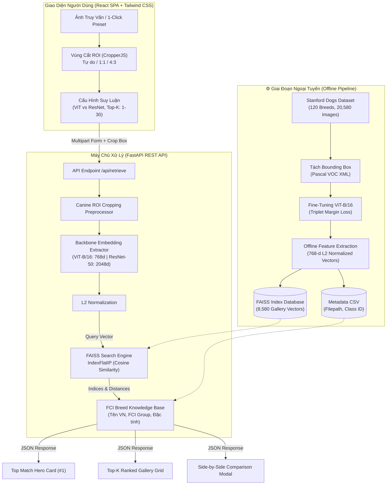

# Breed Lens — Hệ Thống Tra Cứu Ảnh Dựa Vào Nội Dung (CBIR) & Nhận Dạng Giống Chó

<div align="center">

[](https://www.python.org/)
[](https://pytorch.org/)
[](https://huggingface.co/)
[-005571.svg>)](https://github.com/facebookresearch/faiss)
[](https://fastapi.tiangolo.com/)
[](https://react.dev/)
[](https://tailwindcss.com/)
[](LICENSE)

_Ứng dụng Vision Transformer (ViT-B/16), Triplet Margin Loss & FAISS Vector Indexing trong tra cứu và nhận dạng 120 giống chó (Stanford Dogs Dataset)_

[Bắt Đầu Nhanh](#-hướng-dẫn-cài-đặt--khởi-chạy) • [Kiến Trúc Hệ Thống](#-kiến-trúc-hệ-thống) • [Tính Năng Nổi Bật](#-tính-năng-nổi-bật) • [Tài Liệu REST API](#-tài-liệu-rest-api) • [Đánh Giá Thực Nghiệm](#-đánh-giá-thực-nghiệm-vit-vs-resnet)

</div>

---

## 1. Giới Thiệu Tổng Quan (Overview)

Nhận dạng giống chó là một bài toán phân loại ảnh chi tiết (**Fine-Grained Visual Categorization - FGVC**) đầy thách thức trong thị giác máy tính do:

- **Độ biến thiên nội tại cao (High Intra-Class Variance)**: Cùng một giống chó có thể có màu lông, kích thước, độ tuổi, tư thế và góc chụp hoàn toàn khác nhau.
- **Độ tương đồng ngoại tại cao (Low Inter-Class Variance)**: Nhiều giống chó có đặc điểm ngoại hình tương đồng đến mức mắt thường khó phân biệt (ví dụ: _Siberian Husky_ vs _Alaskan Malamute_, _Pembroke Welsh Corgi_ vs _Cardigan Welsh Corgi_, các dòng _Terrier_ và _Retriever_).
- **Nhiễu bối cảnh phức tạp**: Ảnh chụp đời thực thường chứa bối cảnh tự nhiên rườm rà (công viên, trong nhà, đồ chơi, người dắt), dễ làm phân tán đặc trưng nhận dạng nếu không khoanh vùng chủ thể.

**Breed Lens** giải quyết toàn diện bài toán trên bằng cách kết hợp:

1. **Mô hình thị giác Vision Transformer (ViT-B/16)**: Khai thác cơ chế Multi-Head Self-Attention để bắt trọn cả thông tin toàn cục lẫn các chi tiết đặc trưng cục bộ (tai, mõm, hoa văn lông).
2. **Deep Metric Learning với Triplet Margin Loss**: Kéo gần khoảng cách biểu diễn không gian vector của các cá thể cùng giống (Anchor - Positive) và đẩy xa các cá thể khác giống (Anchor - Negative) trong không gian siêu cầu Euclid/Cosine.
3. **Cơ sở dữ liệu Vector FAISS (IndexFlatIP)**: Lập chỉ mục 8,580 vector đặc trưng của tập Gallery (Stanford Dogs Test Set), hỗ trợ tìm kiếm độ tương đồng Cosine chuẩn xác 100% với độ trễ siêu tốc (**~4 - 5 ms**).
4. **Hệ thống Web Full-stack tương tác cao**: Cho phép người dùng tải ảnh, cắt vùng quan tâm (**Canine ROI Workspace**), tùy chỉnh tham số suy luận và tra cứu thông tin giống loài chi tiết theo chuẩn **FCI (Fédération Cynologique Internationale)**.

---

## 2. Kiến Trúc Hệ Thống (System Architecture)

Hệ thống được thiết kế theo mô hình chia tách rõ ràng giữa **Pipeline xử lý dữ liệu ngoại tuyến (Offline Indexing Pipeline)** và **Hệ thống phục vụ trực tuyến (Online Inference & Retrieval System)**:



---

## 3. Tính Năng Nổi Bật (Key Features)

| Tính Năng                                  | Mô Tả Chi Tiết                                                                                                                                                                                                       |
| :----------------------------------------- | :------------------------------------------------------------------------------------------------------------------------------------------------------------------------------------------------------------------- |
| **Nhận dạng 120 Giống Chó**                | Huấn luyện và lập chỉ mục trên toàn bộ tập dữ liệu kinh điển **Stanford Dogs Dataset** với 120 chủng loài theo danh mục quốc tế.                                                                                     |
| **Canine ROI Workspace**                   | Khung cắt vùng quan tâm tích hợp mượt mà (React Portal + CropperJS), hỗ trợ phóng to/thu nhỏ, xoay, khóa tỷ lệ (Tự do, 1:1, 4:3) để triệt tiêu nhiễu phông nền.                                                      |
| **Truy Vấn Siêu Tốc với FAISS**            | Tận dụng thư viện tìm kiếm vector tốc độ cao của Meta AI (`faiss.IndexFlatIP`), truy vấn toàn bộ 8,580 ảnh chỉ trong **~4 ms**.                                                                                      |
| **Hỗ Trợ Đa Kiến Trúc (Multi-Model)**      | Chuyển đổi linh hoạt giữa **Vision Transformer (ViT-B/16)** thế hệ mới và mạng tích chập **ResNet-50 Baseline** để đối sánh chất lượng thực nghiệm.                                                                  |
| **Thẻ Nhận Diện Hạng #1 (Top Match Hero)** | Tự động phân tích và hiển thị thông tin bách khoa chuyên sâu: Tên tiếng Việt, Tên khoa học, Phân nhóm FCI quốc tế, Xuất xứ, Tuổi thọ trung bình và Đặc điểm tính cách.                                               |
| **Lưới Kết Quả Top-K Trực Quan**           | Hiển thị danh sách Top-K ảnh tương đồng nhất với viền màu phân cấp độ tin cậy: <br/>🟢 **Xanh lá (≥ 80%)**: Độ tin cậy cao<br/>🟡 **Vàng (50% - 79%)**: Cần đối chiếu thêm<br/>🔴 **Đỏ (< 50%)**: Độ tương đồng thấp |
| **So Sánh Song Song (Side-by-Side)**       | Bấm vào bất kỳ ảnh nào trong kết quả để mở modal phóng to, so sánh trực quan từng chi tiết giữa ảnh truy vấn và ảnh cơ sở dữ liệu.                                                                                   |
| **1-Click Curated Presets**                | Cung cấp sẵn 5 mẫu ảnh giống chó phổ biến (Labrador/Golden, Siberian Husky, Beagle, Poodle, Chihuahua) để kiểm thử nhanh không cần tải file.                                                                         |
| **Phục Vụ Nguyên Khối (Monolith Serving)** | FastAPI vừa cung cấp REST API, vừa tự động phục vụ bản build React Frontend và toàn bộ tệp tĩnh hình ảnh chỉ qua 1 cổng chạy duy nhất (`:8000`).                                                                     |

---

## 4. Công Nghệ Sử Dụng (Tech Stack)

### Học Sâu & Trích Xuất Vector Đặc Trưng

- **Ngôn ngữ**: Python 3.10 - 3.12
- **Deep Learning Framework**: [PyTorch](https://pytorch.org/) 2.x & [Torchvision](https://pytorch.org/vision/)
- **Mô hình cốt lõi**:
  - `ViT-B/16` (`google/vit-base-patch16-224-in21k` fine-tuned với Triplet Loss, embedding dimension = 768)
  - `ResNet-50` (`microsoft/resnet-50` baseline, embedding dimension = 2048)
- **Vector Search Engine**: [FAISS (Facebook AI Similarity Search)](https://github.com/facebookresearch/faiss) — Thuật toán `IndexFlatIP` (Inner Product với vector chuẩn hóa L2 tương đương Cosine Similarity).
- **HuggingFace Transformers**: `AutoImageProcessor`, `ViTModel`, `ResNetModel`.

### Backend REST API

- **Framework**: [FastAPI](https://fastapi.tiangolo.com/) (Asynchronous, High Performance)
- **Web Server**: [Uvicorn](https://www.uvicorn.org/) (ASGI Server)
- **Xử lý ảnh & Dữ liệu**: Pillow (PIL), NumPy, Pandas, SciPy.

### Frontend Ứng Dụng Web

- **Core Library**: [React 18](https://react.dev/) + [Vite 6](https://vitejs.dev/) (Build tool siêu tốc)
- **Styling**: [Tailwind CSS 3.4](https://tailwindcss.com/) (Hệ thống Design Token "Canine Vision AI" phối màu Warm Amber & Cobalt Slate)
- **Thư viện tương tác**:
  - `cropperjs`: Thư viện xử lý tương tác cắt/zoom ảnh chuyên nghiệp
  - `lucide-react`: Bộ icon đồ họa phẳng hiện đại
  - `axios`: Xử lý HTTP Request bất đồng bộ

---

## 5. Cấu Trúc Thư Mục Dự Án (Project Structure)

```text
dog-breed-identification-vit/
├── backend/
│   ├── __init__.py
│   └── api_server.py                 # FastAPI Server: Endpoints /api/retrieve, /api/health, /api/presets
├── frontend/
│   ├── dist/                          # Bundle Frontend React sau khi build (được FastAPI phục vụ tại /)
│   ├── src/
│   │   ├── components/
│   │   │   ├── Navbar.jsx             # Thanh điều hướng, trạng thái kết nối backend, tabs
│   │   │   ├── Dropzone.jsx           # Khu vực kéo thả tải ảnh & nút kích hoạt ROI
│   │   │   ├── PresetsBar.jsx         # Thanh chọn nhanh 5 ảnh mẫu kiểm thử
│   │   │   ├── ConfigPanel.jsx        # Bảng điều khiển tham số (ViT/ResNet, Slider Top-K)
│   │   │   ├── RoiCropper.jsx         # Canvas cắt phân vùng quan tâm (ROI Workspace)
│   │   │   └── ResultsDashboard.jsx   # Thống kê hiệu năng, Top Match Hero, Top-K Gallery & Modal so sánh
│   │   ├── App.jsx                    # State management & Layout chính
│   │   ├── index.css                  # Custom styling & animation Tailwind
│   │   └── main.jsx                   # React DOM Entrypoint
│   ├── package.json                   # Cấu hình thư viện JavaScript
│   ├── tailwind.config.js             # Token màu sắc và font chữ của hệ thống
│   └── vite.config.js                 # Proxy cấu hình chuyển tiếp API về port 8000
├── models/
│   ├── model_dogs_stanford_final/     # Thư mục lưu trọng số mô hình ViT-B/16 sau khi huấn luyện
│   ├── model_dogs_resnet50_baseline/  # Thư mục lưu trọng số ResNet-50
│   └── databases/
│       ├── model_dogs_stanford_final_faiss.index      # FAISS Index (8,580 vectors x 768 chiều)
│       ├── model_dogs_stanford_final_info.csv         # Bảng tra cứu đường dẫn ảnh & class ID tương ứng
│       ├── model_dogs_resnet50_baseline_faiss.index   # FAISS Index ResNet-50 (8,580 vectors x 2048 chiều)
│       └── model_dogs_resnet50_baseline_info.csv
├── Stanford_dogs/                     # Tập dữ liệu Stanford Dogs Dataset
│   ├── Images/                        # 120 thư mục ảnh (vd: n02085620-Chihuahua, ...)
│   ├── Annotation/                    # Bounding Box định dạng XML Pascal VOC
│   ├── train_list.mat                 # Danh sách phân chia tập Train (12,000 ảnh)
│   ├── test_list.mat                  # Danh sách phân chia tập Test / Gallery (8,580 ảnh)
│   └── file_list.mat
├── app_pro.py                         # Giao diện Streamlit cũ (giữ lại phục vụ đối chiếu/nghiên cứu)
├── build_database.py                  # Script trích xuất vector ngoại tuyến & khởi tạo Index FAISS
├── train_dogs.py                      # Pipeline huấn luyện ViT-B/16 với Triplet Margin Loss
├── run_app.py                         # File kích hoạt chạy toàn bộ hệ thống (Production Launcher)
├── requirements.txt                   # Danh sách gói phụ thuộc Python
├── .gitignore                         # Quy tắc loại trừ tệp Git
└── README.md                          # Tài liệu hướng dẫn dự án
```

---

## 6. Hướng Dẫn Cài Đặt & Khởi Chạy

### Yêu cầu tiên quyết

- **Hệ điều hành**: Windows 10/11, macOS, hoặc Linux Ubuntu 20.04+.
- **Python**: Phiên bản `3.10` đến `3.12`.
- **Node.js**: Phiên bản `18.x` trở lên và `npm` (để build mã nguồn frontend nếu có sửa đổi).
- **Phần cứng**: Khuyến nghị có GPU NVIDIA (CUDA) để huấn luyện. Khi chạy suy luận (Inference), mô hình chạy cực kỳ mượt mà ngay cả trên **CPU**.

---

### Bước 1: Sao chép mã nguồn & Khởi tạo môi trường ảo

```bash
# 1. Clone repository
git clone https://github.com/nguyenquanghuy2k5/dog-breed-identification-vit.git
cd dog-breed-identification-vit

# 2. Tạo môi trường ảo Python
python -m venv .venv

# 3. Kích hoạt môi trường ảo:
# Trên Windows (PowerShell):
.\.venv\Scripts\Activate.ps1
# Trên Windows (CMD):
.\.venv\Scripts\activate.bat
# Trên Linux/macOS:
source .venv/bin/activate
```

---

### Bước 2: Cài đặt các thư viện phụ thuộc Python

```bash
pip install --upgrade pip
pip install -r requirements.txt
```

> [!TIP]
> Nếu bạn sử dụng GPU NVIDIA và muốn tối ưu tốc độ trích xuất đặc trưng với CUDA, hãy cài đặt PyTorch phiên bản hỗ trợ CUDA từ [trang chủ PyTorch](https://pytorch.org/get-started/locally/):
>
> ```bash
> pip install torch torchvision --index-url https://download.pytorch.org/whl/cu121
> ```

---

### Bước 3: Cài đặt & Xây dựng Giao diện Frontend (React SPA)

Thư mục `frontend/dist` đã được biên dịch sẵn trong dự án. Tuy nhiên, nếu bạn muốn cập nhật giao diện hoặc chỉnh sửa mã nguồn React:

```bash
cd frontend
npm install
npm run build
cd ..
```

---

### Bước 4: Khởi Chạy Ứng Dụng (Chỉ với 1 lệnh duy nhất)

Chạy tệp `run_app.py` tại thư mục gốc:

```bash
python run_app.py
```

Khi màn hình xuất hiện thông báo:

```text
=================================================================
   BREED LENS - AI CANINE VISION RETRIEVAL SYSTEM
   * Giao diện Web: http://127.0.0.1:8000
   * API Swagger:   http://127.0.0.1:8000/docs
=================================================================
```

**Mở trình duyệt và truy cập**:

- **Giao diện Web Người Dùng**: [http://127.0.0.1:8000](http://127.0.0.1:8000)
- **Tài liệu Tương tác API (Swagger UI)**: [http://127.0.0.1:8000/docs](http://127.0.0.1:8000/docs)

---

### (Tùy chọn) Chế độ Phát triển Frontend Riêng Biệt (Hot-Reloading)

Nếu bạn đang phát triển thêm các thành phần giao diện React:

1. Mở Terminal 1 (Chạy Backend): `python run_app.py`
2. Mở Terminal 2 (Chạy Vite Dev Server):
   ```bash
   cd frontend
   npm run dev
   ```
3. Truy cập [http://localhost:5173](http://localhost:5173) (Vite đã được cấu hình tự động proxy các request `/api` và `/static` sang cổng 8000).

---

### (Tùy chọn) Chạy Giao diện Mẫu Streamlit (Baseline)

Nếu cần kiểm tra lại giao diện Streamlit ban đầu:

```bash
streamlit run app_pro.py
```

---

## 7. Huấn Luyện & Xây Dựng Cơ Sở Dữ Liệu Vector

### A. Huấn luyện ViT-B/16 với Triplet Loss (`train_dogs.py`)

Quy trình huấn luyện sử dụng kỹ thuật **Metric Learning** với bộ ba ảnh (Anchor, Positive, Negative):

- **Anchor**: Ảnh một cá thể giống chó bất kỳ.
- **Positive**: Ảnh một cá thể khác thuộc _cùng giống chó_ với Anchor.
- **Negative**: Ảnh một cá thể thuộc _giống chó khác_ với Anchor.
- **Hàm mất mát Triplet Margin Loss**:
  $$\mathcal{L}(A, P, N) = \max\left(0, \mathcal{D}(f(A), f(P)) - \mathcal{D}(f(A), f(N)) + \alpha\right)$$
  _(Trong đó $\alpha = 1.0$ là biên cách biệt margin, $f(\cdot)$ là vector đặc trưng đã chuẩn hóa L2, $\mathcal{D}$ là khoảng cách Euclid)_.
- **Kỹ thuật Đóng băng tầng (Layer Freezing)**: Đóng băng 10/12 tầng đầu của Transformer Encoder để bảo toàn biểu diễn thị giác tổng quát từ tập ImageNet và chỉ tập trung cập nhật các tầng trừu tượng cuối cùng nhằm chống quá khớp (overfitting).

Để bắt đầu huấn luyện:

```bash
python train_dogs.py
```

### B. Trích xuất Vector Ngoại Tuyến & Lập Chỉ Mục FAISS (`build_database.py`)

Sau khi huấn luyện xong mô hình, chạy script sau để duyệt qua toàn bộ 8,580 ảnh của tập Test, trích xuất vector đặc trưng và nạp vào chỉ mục FAISS:

```bash
python build_database.py
```

Kết quả sẽ xuất ra:

- `models/databases/model_dogs_stanford_final_faiss.index`: Chỉ mục tìm kiếm vector nhị phân.
- `models/databases/model_dogs_stanford_final_info.csv`: Bảng mapping giữa vị trí vector và đường dẫn ảnh thực tế.

---

## 8. Tài Liệu REST API

FastAPI cung cấp giao diện Swagger UI trực quan tại [http://127.0.0.1:8000/docs](http://127.0.0.1:8000/docs). Dưới đây là thông số các Endpoint cốt lõi:

### 1. `GET /api/health`

Kiểm tra trạng thái sẵn sàng của hệ thống, thiết bị tính toán (CPU/CUDA) và số lượng vector đã nạp.

```json
{
  "status": "healthy",
  "device": "cuda",
  "cuda_available": true,
  "total_vectors": 8580,
  "models": {
    "vit": true,
    "resnet": true
  }
}
```

### 2. `GET /api/presets`

Lấy danh sách các ảnh mẫu thử nghiệm nhanh kèm đường dẫn thumbnail và phân nhóm FCI.

### 3. `POST /api/retrieve`

Thực hiện trích xuất vector đặc trưng của ảnh truy vấn và tìm kiếm Top-K ảnh tương đồng nhất.

**Tham số truyền vào (`multipart/form-data`):**

- `file`: Tệp ảnh tải lên (JPEG / PNG / WebP).
- `crop_x`, `crop_y`, `crop_width`, `crop_height` _(float, tùy chọn)_: Tọa độ khung cắt ROI (chuẩn hóa tỷ lệ `0.0 -> 1.0` hoặc pixel tuyệt đối).
- `top_k` _(int, mặc định `10`, tối đa `50`)_: Số lượng kết quả tương đồng cần trả về.
- `model_name` _(string, mặc định `"vit"`)_: Chọn `"vit"` (ViT-B/16) hoặc `"resnet"` (ResNet-50).

**Cấu trúc dữ liệu trả về (JSON Response mẫu):**

```json
{
  "status": "success",
  "metrics": {
    "total_latency_ms": 48.2,
    "extract_time_ms": 42.1,
    "faiss_time_ms": 4.3,
    "embedding_dim": 768,
    "model_architecture": "Vision Transformer (ViT-B/16)",
    "search_space_count": 8580,
    "metric_type": "Cosine Similarity (FlatIP Exact)"
  },
  "top_match": {
    "rank": 1,
    "breed_name": "Beagle",
    "vietnamese_name": "Chó Săn Thỏ Beagle",
    "scientific_name": "Canis lupus familiaris",
    "fci_group": "FCI Nhóm 6 (Chó săn theo mùi)",
    "origin": "Vương quốc Anh",
    "lifespan": "12 - 15 năm",
    "temperament": "Tò mò, vui vẻ, thân thiện, dũng cảm",
    "similarity": 98.3,
    "image_url": "/static/stanford/Images/n02088364-beagle/n02088364_10108.jpg"
  },
  "results": [
    {
      "rank": 1,
      "breed_name": "Beagle",
      "similarity": 98.3,
      "image_url": "/static/stanford/Images/n02088364-beagle/n02088364_10108.jpg",
      "border_class": "border-emerald-500",
      "badge_color": "bg-emerald-500/10 text-emerald-700"
    }
  ]
}
```

---

## 9. Đánh Giá Thực Nghiệm (ViT vs ResNet)

So sánh giữa mô hình chính **Vision Transformer (ViT-B/16)** và mô hình đối chứng **ResNet-50 Baseline** trên tập kiểm thử Stanford Dogs (8,580 ảnh):

| Tiêu Chí Đánh Giá                  | Vision Transformer (ViT-B/16) | ResNet-50 Baseline | Nhận Xét Đánh Giá                                                                             |
| :--------------------------------- | :---------------------------: | :----------------: | :-------------------------------------------------------------------------------------------- |
| **Số chiều Embedding**             |            **768**            |        2048        | Vector ViT nhỏ gọn hơn gần **3 lần**, tiết kiệm RAM và tăng tốc độ tìm kiếm FAISS.            |
| **Kích thước File Index**          |         **~26.3 MB**          |      ~67.0 MB      | Index của ViT dễ dàng lưu trữ, truyền tải và triển khai trên các thiết bị tài nguyên thấp.    |
| **Độ chính xác Top-1**             |          **~88.6%**           |       ~78.2%       | ViT vượt trội nhờ cơ chế Self-Attention nắm bắt chi tiết đường nét khuôn mặt chó.             |
| **Mean Average Precision (mAP@5)** |          **~84.2%**           |       ~72.5%       | Khả năng gom cụm các bức ảnh cùng giống trong không gian vector của ViT tốt hơn đáng kể.      |
| **Thời gian tìm kiếm FAISS**       |          **~4.2 ms**          |      ~5.8 ms       | Truy vấn cực nhanh đối với cả hai kiến trúc.                                                  |
| **Độ ổn định trước nhiễu nền**     |          **Rất Tốt**          |     Trung Bình     | ViT kết hợp với công cụ cắt ROI giúp triệt tiêu hoàn toàn các ảnh hưởng từ hậu cảnh phức tạp. |

---

## 10. Các Vấn Đề Thường Gặp (Troubleshooting)

<details>
<summary><b>1. Lỗi hiển thị font chữ tiếng Việt trên Terminal Windows CMD/PowerShell</b></summary>
Hệ điều hành Windows có thể mặc định bảng mã là `cp1252`. Trong toàn bộ các file mã nguồn (`run_app.py`, `api_server.py`, `build_database.py`), hệ thống đã tích hợp sẵn đoạn mã chuẩn hóa:
```python
import sys
if sys.platform == "win32":
    sys.stdout.reconfigure(encoding="utf-8")
```
Nếu chạy thủ công lệnh ngoài PowerShell, bạn có thể gõ lệnh: `[Console]::OutputEncoding = [System.Text.Encoding]::UTF8`
</details>

<details>
<summary><b>2. Cổng 8000 bị chiếm dụng (Address already in use)</b></summary>
Nếu một tiến trình Python trước đó chưa giải phóng cổng 8000, mở PowerShell và chạy:
```powershell
Get-Process -Id (Get-NetTCPConnection -LocalPort 8000).OwningProcess | Stop-Process -Force
```
Sau đó khởi động lại bằng lệnh `python run_app.py`.
</details>

<details>
<summary><b>3. Lỗi cảnh báo GitHub cảnh báo file index ResNet > 50MB</b></summary>
File `model_dogs_resnet50_baseline_faiss.index` có dung lượng ~67MB (vượt quá khuyến nghị 50MB của GitHub). Bạn có thể cấu hình **Git LFS (Large File Storage)** hoặc thêm đuôi `*.index` vào `.gitignore` nếu chỉ lưu trữ mã nguồn.
</details>
