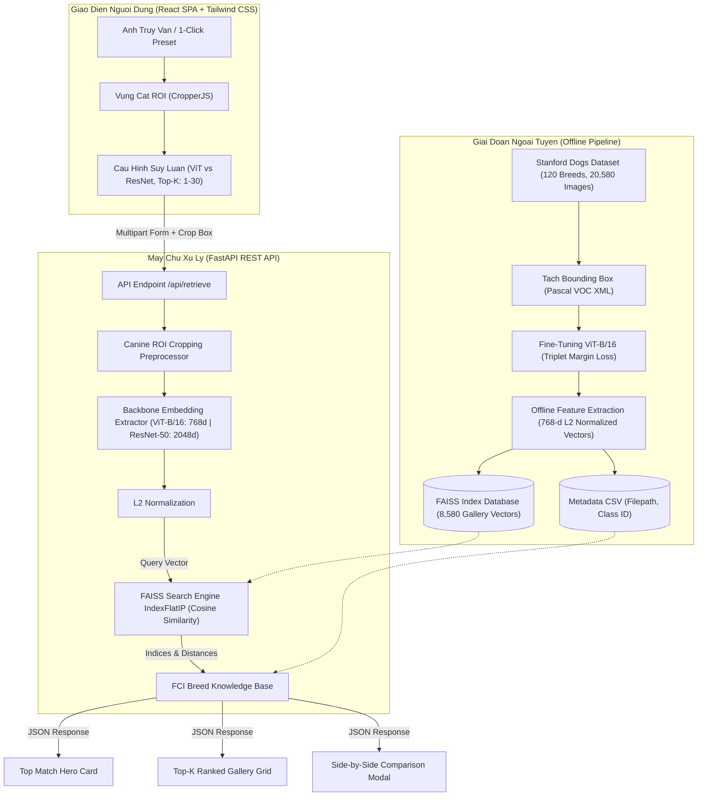

# Breed Lens — Hệ Thống Tra Cứu Ảnh Dựa Vào Nội Dung (CBIR) & Nhận Dạng Giống Chó

<div align="center">

[](https://www.python.org/)
[](https://pytorch.org/)
[](https://huggingface.co/)
[](https://github.com/facebookresearch/faiss)
[](https://fastapi.tiangolo.com/)
[](https://react.dev/)
[](https://tailwindcss.com/)

_Nghiên cứu & Xây dựng hệ thống CBIR nhận dạng giống loài dựa trên kiến trúc Vision Transformer và chỉ mục vector FAISS_

</div>

---

## 1. Giới Thiệu Tổng Quan

Nhận dạng giống chó là một bài toán phân loại ảnh chi tiết (**Fine-Grained Visual Categorization - FGVC**) đầy thách thức trong thị giác máy tính do:

- **Độ biến thiên nội tại cao (High Intra-Class Variance)**: Cùng một giống chó có thể có màu lông, kích thước, độ tuổi, tư thế và góc chụp hoàn toàn khác nhau.
- **Độ tương đồng ngoại tại cao (Low Inter-Class Variance)**: Nhiều giống chó có đặc điểm ngoại hình tương đồng đến mức mắt thường khó phân biệt, ví dụ: _Siberian Husky_ vs _Alaskan Malamute_, _Pembroke Welsh Corgi_ vs _Cardigan Welsh Corgi_, các dòng _Terrier_ và _Retriever_.
- **Nhiễu bối cảnh phức tạp**: Ảnh chụp đời thực thường chứa bối cảnh tự nhiên rườm rà (công viên, trong nhà, đồ chơi, người dắt), dễ làm phân tán đặc trưng nhận dạng nếu không khoanh vùng chủ thể.

**Breed Lens** giải quyết toàn diện bài toán trên bằng cách kết hợp:

1. **Mô hình thị giác Vision Transformer (ViT-B/16)**: Khai thác cơ chế Multi-Head Self-Attention để bắt trọn cả thông tin toàn cục lẫn các chi tiết đặc trưng cục bộ như tai, mõm, hoa văn lông.
2. **Deep Metric Learning với Triplet Margin Loss**: Kéo gần khoảng cách biểu diễn không gian vector của các cá thể cùng giống (Anchor - Positive) và đẩy xa các cá thể khác giống (Anchor - Negative).
3. **Cơ sở dữ liệu Vector FAISS (IndexFlatIP)**: Lập chỉ mục 8.580 vector đặc trưng của tập Gallery (Stanford Dogs Test Set), hỗ trợ tìm kiếm độ tương đồng Cosine chính xác 100% với độ trễ chỉ ~4–5 ms.
4. **Hệ thống Web Full-stack tương tác cao**: Cho phép người dùng tải ảnh, cắt vùng quan tâm (Canine ROI Workspace), tùy chỉnh tham số suy luận và tra cứu thông tin giống loài chi tiết theo chuẩn **FCI (Fédération Cynologique Internationale)**.

---

## 2. Kiến Trúc Hệ Thống

Hệ thống được thiết kế theo mô hình chia tách rõ ràng giữa **Pipeline xử lý dữ liệu ngoại tuyến (Offline Indexing Pipeline)** và **Hệ thống phục vụ trực tuyến (Online Inference & Retrieval System)**:



---

## 3. Tính Năng Nổi Bật

| Tính Năng                             | Mô Tả Chi Tiết                                                                                                                                                                     |
| :------------------------------------ | :--------------------------------------------------------------------------------------------------------------------------------------------------------------------------------- |
| **Nhận dạng 120 Giống Chó**           | Huấn luyện và lập chỉ mục trên toàn bộ tập dữ liệu **Stanford Dogs Dataset** với 120 chủng loài theo danh mục quốc tế.                                                             |
| **Canine ROI Workspace**              | Khung cắt vùng quan tâm tích hợp mượt mà (React Portal + CropperJS), hỗ trợ phóng to/thu nhỏ, xoay, khóa tỷ lệ (Tự do, 1:1, 4:3) để triệt tiêu nhiễu phông nền.                    |
| **Truy Vấn Siêu Tốc với FAISS**       | Tận dụng thư viện tìm kiếm vector tốc độ cao của Meta AI (`faiss.IndexFlatIP`), truy vấn toàn bộ 8.580 ảnh chỉ trong ~4 ms.                                                        |
| **Hỗ Trợ Đa Kiến Trúc**               | Chuyển đổi linh hoạt giữa **Vision Transformer (ViT-B/16)** thế hệ mới và mạng tích chập **ResNet-50 Baseline** để đối sánh chất lượng thực nghiệm.                                |
| **Thẻ Nhận Diện Hạng #1 (Top Match)** | Tự động hiển thị thông tin bách khoa: Tên tiếng Việt, Tên khoa học, Phân nhóm FCI quốc tế, Xuất xứ, Tuổi thọ trung bình và Đặc điểm tính cách.                                     |
| **Lưới Kết Quả Top-K Trực Quan**      | Hiển thị Top-K ảnh tương đồng nhất với viền màu phân cấp: Xanh lá (>=80%), Vàng (50–79%), Đỏ (<50%).                                                                               |
| **So Sánh Song Song**                 | Bấm vào bất kỳ ảnh nào trong kết quả để mở modal phóng to, so sánh trực quan giữa ảnh truy vấn và ảnh cơ sở dữ liệu.                                                               |
| **Lịch Sử Tra Cứu**                   | Tự động lưu các lượt tra cứu vào LocalStorage của trình duyệt, hiển thị thumbnail và kết quả nhận dạng. Có thể khôi phục toàn bộ kết quả phân tích của phiên cũ chỉ với 1 lần bấm. |
| **1-Click Curated Presets**           | Cung cấp sẵn 5 mẫu ảnh giống chó phổ biến (Labrador/Golden, Siberian Husky, Beagle, Poodle, Chihuahua) để kiểm thử nhanh mà không cần tải file.                                    |
| **Trang Thông Tin Mô Hình**           | Tab "Mô hình ViT & ResNet" hiển thị đầy đủ kiến trúc mạng, pipeline trích xuất vector, thông số FAISS Index, bảng so sánh hiệu suất và thông tin Stanford Dogs Dataset.            |
| **Phục Vụ Nguyên Khối**               | FastAPI vừa cung cấp REST API, vừa tự động phục vụ bản build React Frontend và toàn bộ tệp tĩnh hình ảnh chỉ qua 1 cổng duy nhất (`:8000`).                                        |

---

## 4. Công Nghệ Sử Dụng

### Học Sâu & Trích Xuất Vector Đặc Trưng

- **Ngôn ngữ**: Python 3.10 – 3.12
- **Deep Learning Framework**: PyTorch 2.x & Torchvision
- **Mô hình cốt lõi**:
  - `ViT-B/16`: `google/vit-base-patch16-224-in21k` được fine-tune với Triplet Loss, chiều embedding = 768
  - `ResNet-50`: `microsoft/resnet-50` baseline, chiều embedding = 2048
- **Vector Search Engine**: FAISS — Thuật toán `IndexFlatIP` (Inner Product với vector chuẩn hóa L2 tương đương Cosine Similarity)
- **HuggingFace Transformers**: `AutoImageProcessor`, `ViTModel`, `ResNetModel`

### Backend REST API

- **Framework**: FastAPI (bất đồng bộ, hiệu suất cao)
- **Web Server**: Uvicorn (ASGI Server)
- **Xử lý ảnh & Dữ liệu**: Pillow (PIL), NumPy, Pandas, SciPy

### Frontend Ứng Dụng Web

- **Core Library**: React 18 + Vite 6
- **Styling**: Tailwind CSS 3.4 với hệ thống Design Token phối màu Warm Amber & Cobalt Slate
- **Thư viện tương tác**: `cropperjs` (cắt/zoom ảnh), `lucide-react` (icon), `axios` (HTTP Client)

---

## 5. Cấu Trúc Thư Mục Dự Án

```text
dog-breed-identification-vit/
├── backend/
│   ├── __init__.py
│   └── api_server.py                 # FastAPI Server: /api/retrieve, /api/health, /api/presets
├── frontend/
│   ├── dist/                          # Bundle React sau khi build (được FastAPI phục vụ tại /)
│   ├── src/
│   │   ├── components/
│   │   │   ├── Navbar.jsx             # Thanh điều hướng với 3 tab chính
│   │   │   ├── Dropzone.jsx           # Khu vực kéo thả tải ảnh & nút kích hoạt ROI
│   │   │   ├── PresetsBar.jsx         # Thanh chọn nhanh 5 ảnh mẫu kiểm thử
│   │   │   ├── ConfigPanel.jsx        # Bảng điều khiển tham số (ViT/ResNet, Slider Top-K)
│   │   │   ├── RoiCropper.jsx         # Canvas cắt phân vùng quan tâm (ROI Workspace)
│   │   │   ├── ResultsDashboard.jsx   # Thống kê hiệu năng, Top Match, Top-K Gallery & Modal
│   │   │   ├── HistoryView.jsx        # Trang lịch sử tra cứu (LocalStorage)
│   │   │   └── ModelHub.jsx           # Trang thông tin kiến trúc mô hình, FAISS, dataset
│   │   ├── App.jsx                    # Quản lý trạng thái & Layout chính
│   │   ├── index.css                  # Custom styling & animation Tailwind
│   │   └── main.jsx                   # React DOM Entrypoint
│   ├── package.json
│   ├── tailwind.config.js
│   └── vite.config.js                 # Proxy cấu hình chuyển tiếp API về port 8000
├── models/
│   ├── model_dogs_stanford_final/     # Trọng số mô hình ViT-B/16 sau khi huấn luyện
│   ├── model_dogs_resnet50_baseline/  # Trọng số ResNet-50
│   └── databases/
│       ├── model_dogs_stanford_final_faiss.index      # FAISS Index (8,580 vectors x 768 chiều)
│       ├── model_dogs_stanford_final_info.csv         # Metadata: đường dẫn ảnh & class ID
│       ├── model_dogs_resnet50_baseline_faiss.index   # FAISS Index ResNet-50 (x 2048 chiều)
│       └── model_dogs_resnet50_baseline_info.csv
├── Stanford_dogs/                     # Tập dữ liệu Stanford Dogs Dataset
│   ├── Images/                        # 120 thư mục ảnh (vd: n02085620-Chihuahua)
│   ├── Annotation/                    # Bounding Box định dạng XML Pascal VOC
│   ├── train_list.mat                 # Danh sách tập Train (12.000 ảnh)
│   ├── test_list.mat                  # Danh sách tập Test / Gallery (8.580 ảnh)
│   └── file_list.mat
├── app_pro.py                         # Giao diện Streamlit cũ (giữ lại để đối chiếu)
├── build_database.py                  # Trích xuất vector ngoại tuyến & khởi tạo FAISS Index
├── train_dogs.py                      # Pipeline huấn luyện ViT-B/16 với Triplet Margin Loss
├── run_app.py                         # Launcher khởi chạy toàn bộ hệ thống
├── requirements.txt                   # Danh sách gói phụ thuộc Python
├── .gitignore
└── README.md
```

---

## 6. Hướng Dẫn Cài Đặt & Khởi Chạy

### Yêu cầu tiên quyết

- **Hệ điều hành**: Windows 10/11, macOS, hoặc Linux Ubuntu 20.04+
- **Python**: Phiên bản `3.10` đến `3.12`
- **Node.js**: Phiên bản `18.x` trở lên và `npm` (cần thiết nếu muốn chỉnh sửa và build lại giao diện)
- **Phần cứng**: Khuyến nghị GPU NVIDIA (CUDA) để huấn luyện. Khi chạy suy luận (Inference), mô hình hoạt động mượt mà ngay cả trên CPU.

---

### Bước 1 — Sao chép mã nguồn & Khởi tạo môi trường ảo

```bash
git clone https://github.com/nguyenquanghuy2k5/dog-breed-identification-vit.git
cd dog-breed-identification-vit

# Tạo môi trường ảo Python
python -m venv .venv

# Kích hoạt môi trường ảo
# Windows (PowerShell):
.\.venv\Scripts\Activate.ps1
# Windows (CMD):
.\.venv\Scripts\activate.bat
# Linux / macOS:
source .venv/bin/activate
```

---

### Bước 2 — Cài đặt các thư viện phụ thuộc Python

```bash
pip install --upgrade pip
pip install -r requirements.txt
```

> **Lưu ý GPU**: Nếu sử dụng GPU NVIDIA với CUDA, cài đặt PyTorch phiên bản CUDA từ trang chủ PyTorch:
>
> ```bash
> pip install torch torchvision --index-url https://download.pytorch.org/whl/cu121
> ```

---

### Bước 3 — Cài đặt & Xây dựng Giao diện Frontend

Thư mục `frontend/dist` đã được biên dịch sẵn trong dự án. Nếu muốn cập nhật giao diện hoặc chỉnh sửa mã nguồn React:

```bash
cd frontend
npm install
npm run build
cd ..
```

---

### Bước 4 — Khởi Chạy Ứng Dụng

```bash
python run_app.py
```

Khi màn hình xuất hiện thông báo:

```text
=================================================================
   BREED LENS - AI CANINE VISION RETRIEVAL SYSTEM
   * Giao dien Web: http://127.0.0.1:8000
   * API Swagger:   http://127.0.0.1:8000/docs
=================================================================
```

Mở trình duyệt và truy cập:

- **Giao diện Web**: http://127.0.0.1:8000
- **Tài liệu API (Swagger UI)**: http://127.0.0.1:8000/docs

---

### (Tùy chọn) Chế độ Phát triển Frontend với Hot-Reloading

Nếu đang phát triển thêm các thành phần giao diện React:

1. Terminal 1 — Chạy Backend: `python run_app.py`
2. Terminal 2 — Chạy Vite Dev Server:
   ```bash
   cd frontend
   npm run dev
   ```
3. Truy cập http://localhost:5173 (Vite đã được cấu hình tự động proxy `/api` và `/static` sang cổng 8000.)

---

## 7. Huấn Luyện & Xây Dựng Cơ Sở Dữ Liệu Vector

### A. Huấn luyện ViT-B/16 với Triplet Margin Loss

Quy trình huấn luyện sử dụng kỹ thuật **Metric Learning** với bộ ba ảnh (Anchor, Positive, Negative):

- **Anchor**: Ảnh một cá thể giống chó bất kỳ.
- **Positive**: Ảnh một cá thể khác thuộc _cùng giống chó_ với Anchor.
- **Negative**: Ảnh một cá thể thuộc _giống chó khác_ với Anchor.

Hàm mất mát Triplet Margin Loss:

$$\mathcal{L}(A, P, N) = \max\left(0,\ \mathcal{D}(f(A), f(P)) - \mathcal{D}(f(A), f(N)) + \alpha\right)$$

Trong đó $\alpha = 1.0$ là biên cách biệt margin, $f(\cdot)$ là vector đặc trưng đã chuẩn hóa L2, $\mathcal{D}$ là khoảng cách Euclid.

**Kỹ thuật Đóng băng tầng (Layer Freezing)**: Đóng băng 10/12 tầng đầu của Transformer Encoder để bảo toàn biểu diễn thị giác tổng quát từ tập ImageNet và chỉ cập nhật các tầng trừu tượng cuối cùng nhằm chống quá khớp (overfitting).

```bash
python train_dogs.py
```

### B. Trích xuất Vector Ngoại Tuyến & Lập Chỉ Mục FAISS

Sau khi huấn luyện xong mô hình, chạy script dưới để duyệt qua toàn bộ 8.580 ảnh tập Test, trích xuất vector đặc trưng và nạp vào chỉ mục FAISS:

```bash
python build_database.py
```

Kết quả xuất ra:

- `models/databases/model_dogs_stanford_final_faiss.index` — Chỉ mục tìm kiếm vector nhị phân
- `models/databases/model_dogs_stanford_final_info.csv` — Bảng mapping giữa vị trí vector và đường dẫn ảnh

---

## 8. Tài Liệu REST API

FastAPI cung cấp giao diện Swagger UI tại http://127.0.0.1:8000/docs.

### GET /api/health

Kiểm tra trạng thái sẵn sàng của hệ thống, thiết bị tính toán (CPU/CUDA) và số lượng vector đã nạp.

```json
{
  "status": "healthy",
  "device": "cuda",
  "cuda_available": true,
  "total_vectors": 8580,
  "models": { "vit": true, "resnet": true }
}
```

### GET /api/presets

Lấy danh sách các ảnh mẫu thử nghiệm nhanh kèm đường dẫn thumbnail và phân nhóm FCI.

### POST /api/retrieve

Trích xuất vector đặc trưng của ảnh truy vấn và tìm kiếm Top-K ảnh tương đồng nhất trong cơ sở dữ liệu.

**Tham số truyền vào (`multipart/form-data`):**

| Tham Số                                         | Kiểu   | Mặc Định | Mô Tả                                                         |
| :---------------------------------------------- | :----- | :------- | :------------------------------------------------------------ |
| `file`                                          | File   | Bắt buộc | Tệp ảnh tải lên (JPEG / PNG / WebP)                           |
| `crop_x`, `crop_y`, `crop_width`, `crop_height` | float  | 0.0      | Tọa độ khung cắt ROI (chuẩn hóa 0.0–1.0 hoặc pixel tuyệt đối) |
| `top_k`                                         | int    | 10       | Số lượng kết quả tương đồng cần trả về (tối đa 50)            |
| `model_name`                                    | string | `"vit"`  | Chọn `"vit"` (ViT-B/16) hoặc `"resnet"` (ResNet-50)           |

**JSON Response mẫu:**

```json
{
  "status": "success",
  "metrics": {
    "total_latency_ms": 48.2,
    "extract_time_ms": 42.1,
    "faiss_time_ms": 4.3,
    "embedding_dim": 768,
    "model_architecture": "Vision Transformer (ViT-B/16)",
    "search_space_count": 8580,
    "metric_type": "Cosine Similarity (FlatIP Exact)"
  },
  "top_match": {
    "rank": 1,
    "breed_name": "Beagle",
    "vietnamese_name": "Chó Săn Thỏ Beagle",
    "scientific_name": "Canis lupus familiaris",
    "fci_group": "FCI Nhóm 6 (Chó săn theo mùi)",
    "origin": "Vương quốc Anh",
    "lifespan": "12 - 15 năm",
    "temperament": "Tò mò, vui vẻ, thân thiện, dũng cảm",
    "similarity": 98.3,
    "image_url": "/static/stanford/Images/n02088364-beagle/n02088364_10108.jpg"
  },
  "results": [
    {
      "rank": 1,
      "breed_name": "Beagle",
      "similarity": 98.3,
      "image_url": "/static/stanford/Images/n02088364-beagle/n02088364_10108.jpg"
    }
  ]
}
```

---

## 9. Đánh Giá Thực Nghiệm (ViT-B/16 vs ResNet-50)

So sánh trên tập kiểm thử Stanford Dogs (8.580 ảnh):

| Tiêu Chí Đánh Giá              | Vision Transformer (ViT-B/16) | ResNet-50 Baseline | Nhận Xét                                             |
| :----------------------------- | :---------------------------: | :----------------: | :--------------------------------------------------- |
| Số chiều Embedding             |            **768**            |        2048        | ViT nhỏ gọn hơn ~2,7 lần, FAISS tìm kiếm nhanh hơn   |
| Kích thước File Index          |         **~26,3 MB**          |      ~67,0 MB      | ViT dễ triển khai trên thiết bị tài nguyên thấp      |
| Accuracy@5                     |          **~88,6%**           |       ~78,2%       | ViT vượt trội nhờ global self-attention              |
| Mean Average Precision (mAP@5) |          **~84,2%**           |       ~72,5%       | ViT gom cụm các giống chó tốt hơn đáng kể            |
| FAISS Search Latency           |          **~4,2 ms**          |      ~5,8 ms       | Cả hai đều rất nhanh trong thực tế                   |
| Độ ổn định trước nhiễu nền     |          **Rất tốt**          |     Trung bình     | ViT kết hợp ROI triệt tiêu hoàn toàn nhiễu phông nền |
| Tốc độ Inference CPU           |          Trung bình           |   Nhanh hơn ~20%   | ResNet ít tham số Attention hơn                      |

---

## 10. Các Vấn Đề Thường Gặp

<details>
<summary><b>1. Lỗi hiển thị font chữ tiếng Việt trên Terminal Windows</b></summary>

Hệ điều hành Windows có thể mặc định bảng mã là `cp1252`. Toàn bộ các file mã nguồn (`run_app.py`, `api_server.py`, `build_database.py`) đã tích hợp sẵn đoạn mã chuẩn hóa:

```python
import sys
if sys.platform == "win32":
    sys.stdout.reconfigure(encoding="utf-8")
```

Nếu chạy thủ công lệnh ngoài PowerShell:

```powershell
[Console]::OutputEncoding = [System.Text.Encoding]::UTF8
```

</details>

<details>
<summary><b>2. Cổng 8000 bị chiếm dụng (Address already in use)</b></summary>

Mở PowerShell và chạy:

```powershell
Get-Process -Id (Get-NetTCPConnection -LocalPort 8000).OwningProcess | Stop-Process -Force
```

Sau đó khởi động lại bằng lệnh `python run_app.py`.

</details>

<details>
<summary><b>3. GitHub từ chối push vì file index ResNet quá 50MB</b></summary>

File `model_dogs_resnet50_baseline_faiss.index` có dung lượng ~67MB, vượt quá khuyến nghị 50MB của GitHub. Có thể cấu hình **Git LFS (Large File Storage)** hoặc thêm `*.index` vào `.gitignore` nếu chỉ lưu trữ mã nguồn.

</details>

<details>
<summary><b>4. Lỗi ModuleNotFoundError khi chạy api_server.py trực tiếp</b></summary>

Không chạy trực tiếp `backend/api_server.py`. Hãy sử dụng file launcher:

```bash
python run_app.py
```

File này xử lý chính xác `sys.path` trước khi import module.

</details>
